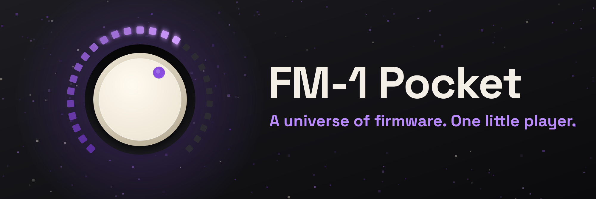
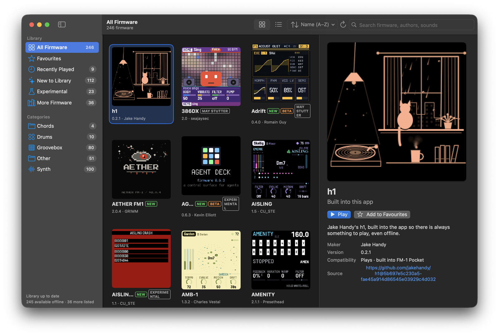
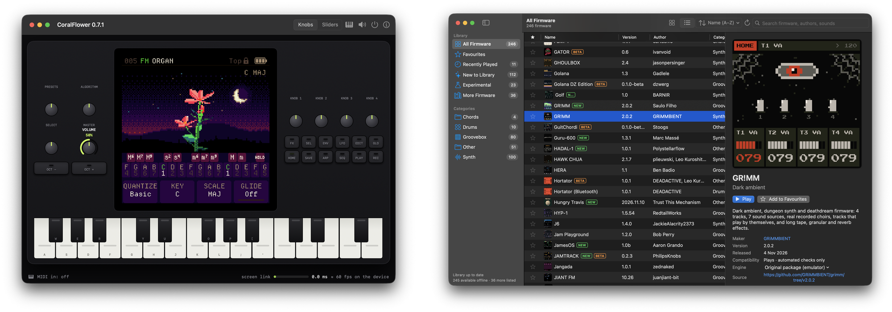

<h1 align="center">FM-1 Pocket</h1>

<strong>A universe of firmware. One little player.</strong>

  <a href="https://github.com/slowphase/fm1-pocket-mac/releases/latest"><strong>Download for macOS</strong></a>
  &nbsp;·&nbsp;
  <a href="https://slowphase.github.io/fm1-pocket-player/"><strong>Try the web player</strong></a>

The M-VAVE FM-1 is a tiny synth that people keep reinventing: its community has written synths, drum machines,
sequencers, trackers and generative instruments for it. FM-1 Pocket gathers that firmware into one library on your
Mac, so you can find something interesting, read what it does and hear it straight away. No FM-1 needed.

## What you can do

- **Discover firmware.** Browse a library that keeps itself up to date, with screen previews, descriptions and
  firmware details. Search by name, maker or description, filter by category, and sort by latest release or A to Z. New
  to Library shows what joined in the last two weeks.
- **Hear it.** Press Play and the firmware runs on a full FM-1 faceplate: its screen, knobs, buttons, lights and keys.
- **Play it your way.** Use the mouse, your computer keyboard or a MIDI keyboard.
- **Keep favourites.** Star your favourites, or return to instruments you've recently explored.
- **Pick up where you left off.** Firmware that saves its own settings keeps them between sessions. What a firmware
  saves, and how, is up to the firmware: some save as you go, others have their own save button.
- **Play offline.** Firmware you have played stays on your Mac, and the library works without a connection.
- **Try your own files.** Open an original FM-1 firmware package (`.fwsc`) from your Mac.

## Install

FM-1 Pocket needs a Mac with Apple silicon (M1 or later) and macOS 14 Sonoma or later.

1. Download the latest `.zip` from [Releases](https://github.com/slowphase/fm1-pocket-mac/releases/latest).
2. Double-click the `.zip` if your Mac hasn't unzipped it already, then drag **FM-1 Pocket** into your
   **Applications** folder.
3. Open it. FM-1 Pocket isn't notarised by Apple, so macOS may block it when first opened. Click **Done** (not Move to Bin),
   open **System Settings › Privacy & Security**, scroll down and click **Open Anyway**.

After that it opens normally. You may need to repeat step 3 when you download a newer version.
[Step-by-step help, with a Terminal alternative](docs/If%20the%20app%20will%20not%20open.txt).

## How firmware plays

FM-1 Pocket is a native Mac app, written in SwiftUI. It has two ways of running firmware:

- **Original packages** (`.fwsc`), exactly as their makers released them, run on an emulation of the FM-1's chip.
- **`.rfm1` builds**, versions of a firmware rebuilt to run on a computer.

FM-1 Pocket recommends an engine based on compatibility and performance checks, and where both work you can switch
between them in a firmware's details.

## Compatibility

Every firmware shows a short compatibility line, such as **Plays · automated checks only** or **Plays · listened to
in FM-1 Pocket**.

Automated checks start each firmware, play it in a scripted test and check that it makes sound and keeps time. That
catches firmware that will not run, but it is not the same as someone playing every feature. Most firmware has only
passed automated checks so far. Known problems are shown as known issues.

If something sounds wrong, [tell us](https://github.com/slowphase/fm1-pocket-player/issues/new?template=firmware-report.yml).

## Credits

FM-1 Pocket is an independent community project. It is not affiliated with or endorsed by M-VAVE.

- Every firmware is the work of its makers and keeps its own licence. Each firmware's details link to its maker and
  source.
- Firmware list: [The Firmware Hub](https://thefirmwarehub.com/) – thefirmwarehub.com, licensed
  [CC BY 4.0](https://creativecommons.org/licenses/by/4.0/).
- Original packages run on [fm1-emu](https://github.com/joakimeriksson/fm1-emu) by Joakim Eriksson (MIT).
- `.rfm1` builds come from [RemoteFM1FW](https://github.com/Quixotic7/RemoteFM1FW) by Michael P Jones (Quixotic7),
  through [FM-1 Pocket Player](https://github.com/slowphase/fm1-pocket-player).
- The `.rfm1` engine is a port of Jake Handy's [FM-1 Browser Simulator](https://github.com/jakehandy/fm1-browser-simulator)
  (MIT), and the built-in h1 is [his firmware](https://github.com/jakehandy/h1) (MIT). It runs on
  [wasm3](https://github.com/wasm3/wasm3) (MIT).

The app's own code is MIT licensed: see [LICENSE](LICENSE) and [THIRD-PARTY-NOTICES.md](THIRD-PARTY-NOTICES.md).

## More

- [FM-1 Pocket Player](https://github.com/slowphase/fm1-pocket-player), the web version
- [Report a firmware problem](https://github.com/slowphase/fm1-pocket-player/issues/new?template=firmware-report.yml)
  or [an app problem](https://github.com/slowphase/fm1-pocket-mac/issues)
- For developers: [DEVELOPMENT.md](docs/DEVELOPMENT.md) and [STORAGE.md](docs/STORAGE.md)
